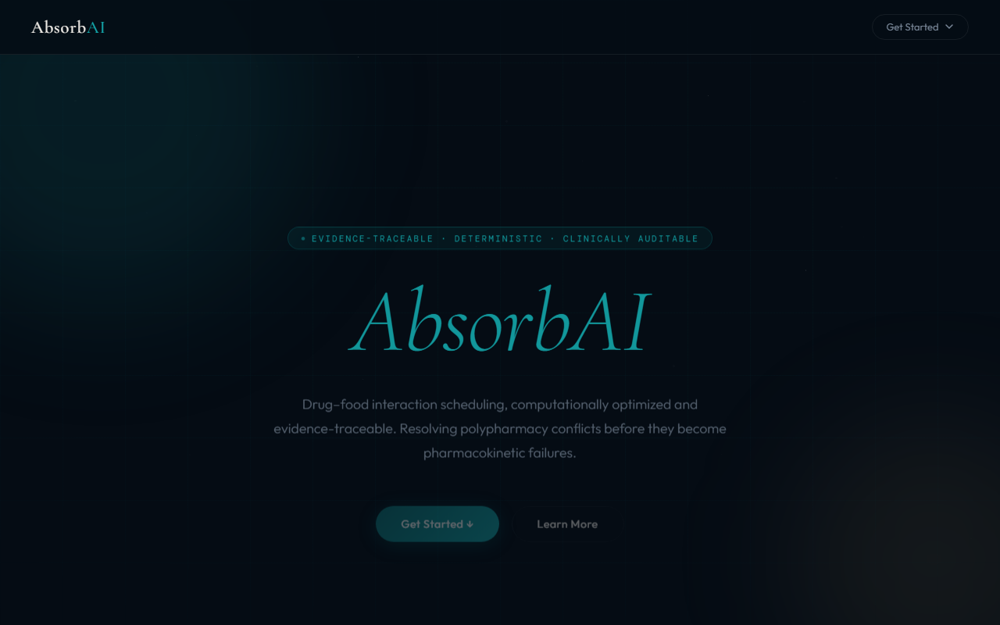
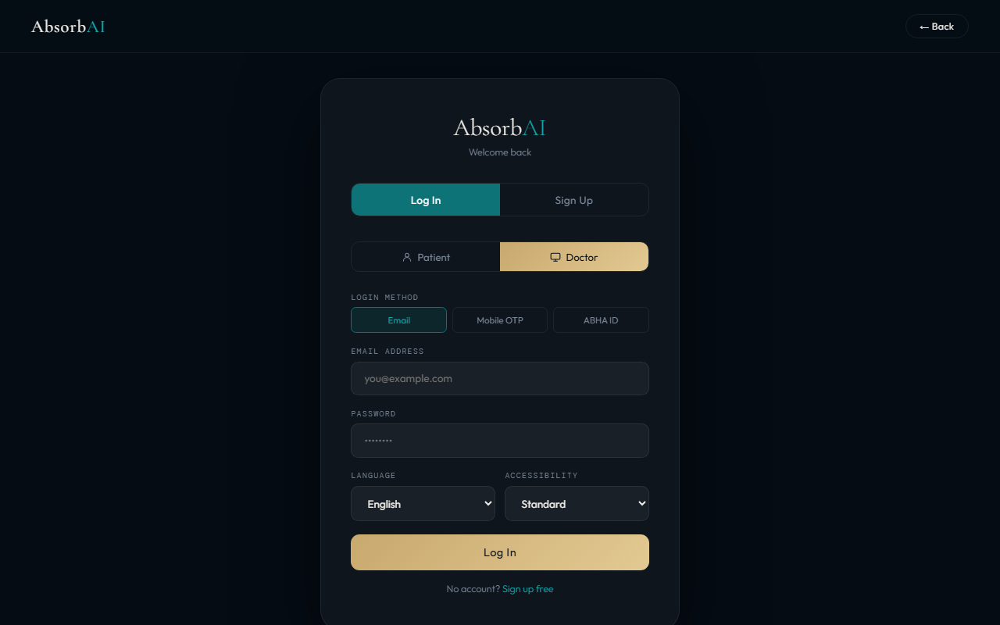
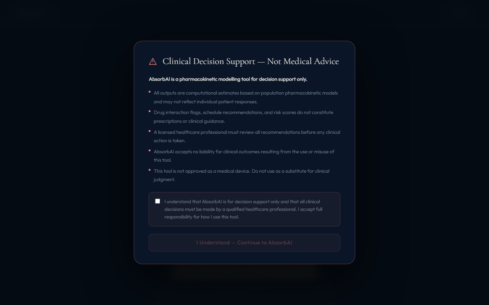
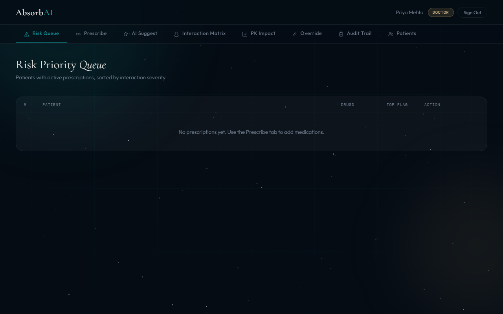
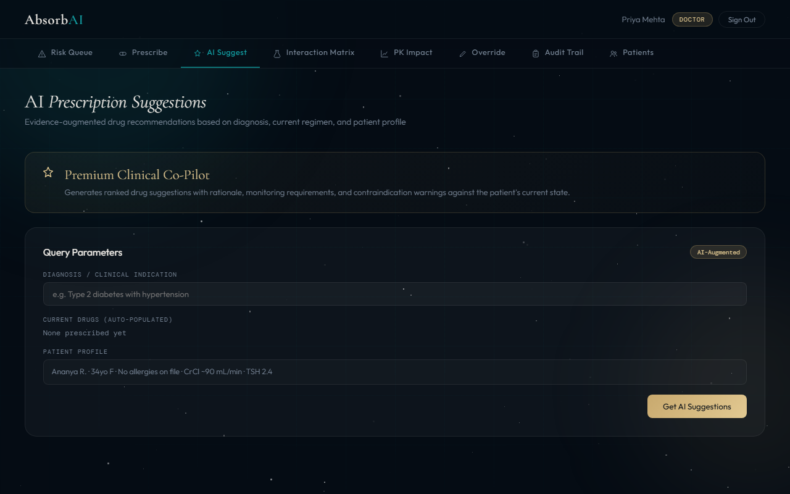
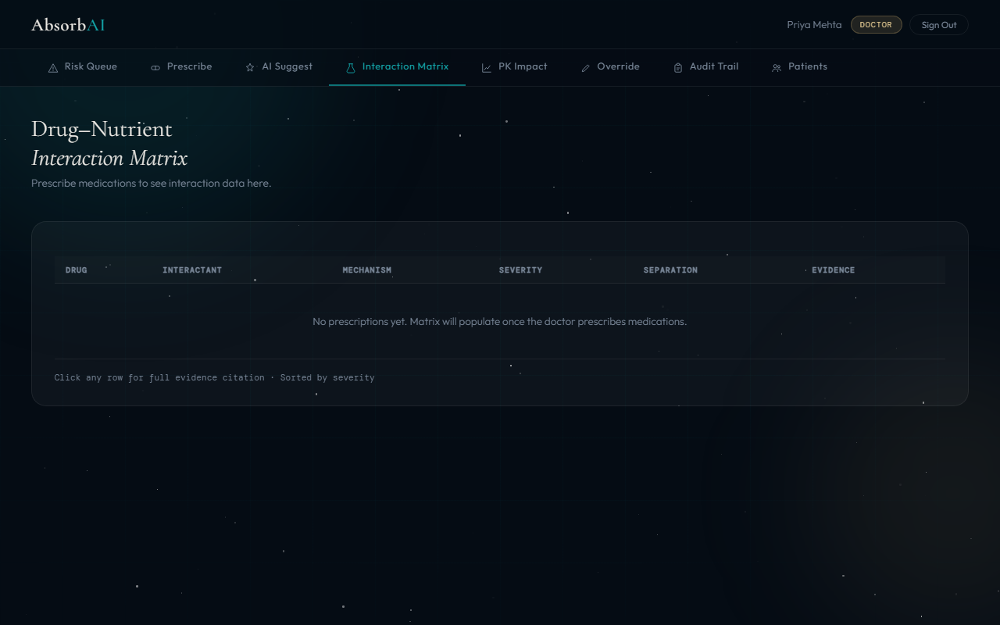
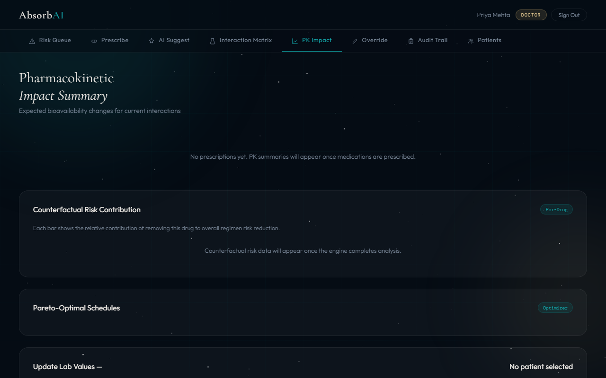

# AbsorbAI

> **Clinical pharmacokinetic decision-support platform** — Personalised drug-interaction analysis, Monte Carlo uncertainty quantification, and evidence-traceable audit trails. For healthcare professionals only. All outputs are decision support, not medical advice.

[](https://python.org)
[](https://djangoproject.com)
[](LICENSE)

---

## Screenshots

<table>
<tr>
<td><br/><sub>Landing page — role selector</sub></td>
<td><br/><sub>Doctor login with multi-method auth</sub></td>
</tr>
<tr>
<td><br/><sub>Clinical decision-support disclaimer</sub></td>
<td><br/><sub>Doctor dashboard — Risk Priority Queue</sub></td>
</tr>
<tr>
<td><br/><sub>AI Prescription Suggestions (evidence-augmented)</sub></td>
<td><br/><sub>Drug–Nutrient Interaction Matrix</sub></td>
</tr>
<tr>
<td colspan="2"><br/><sub>Pharmacokinetic Impact Summary + Counterfactual Risk Contribution</sub></td>
</tr>
</table>

---

## What It Does

AbsorbAI resolves **polypharmacy conflicts before they become pharmacokinetic failures**. Every analysis runs through a 10-layer clinical engine that:

- **Personalises** PK parameters to the individual patient (age, weight, renal/hepatic function, CYP enzyme activity)
- **Simulates** drug concentration over time with a two-compartment model + Monte Carlo uncertainty (100–500 samples)
- **Detects** drug–drug and drug–food interactions from a merged knowledge graph (45 curated drugs, 170+ DDI/FDI)
- **Optimises** dosing schedules via Pareto frontier (minimise peak risk, maximise trough efficacy)
- **Stress-tests** regimens against missed doses, renal impairment, hepatic impairment, and elderly scenarios
- **Explains** every recommendation with a traversable reasoning chain and immutable audit trail
- **Updates** patient-specific Bayesian PK posteriors from real lab observations, persisted across server restarts

---

## Quick Start

```bash
# 1. Clone and create virtualenv
git clone https://github.com/jeyadev-jd/AbsorbAI.git
cd AbsorbAI
python -m venv venv
venv\Scripts\activate        # Windows
# source venv/bin/activate   # Linux/macOS

# 2. Install dependencies
pip install -r requirements.txt

# 3. Configure environment
cp .env.example .env         # edit SECRET_KEY and DEBUG=true

# 4. Run migrations
python manage.py migrate

# 5. Seed demo users (optional)
python manage.py shell -c "
from core.models import AbsorbUser, Patient
AbsorbUser.objects.create_user(username='doctor@demo.com', email='doctor@demo.com', password='doctor123', role='doctor', first_name='Demo', last_name='Doctor')
u = AbsorbUser.objects.create_user(username='patient@demo.com', email='patient@demo.com', password='patient123', role='patient', first_name='Demo', last_name='Patient', patient_key='demo')
Patient.objects.get_or_create(patient_key='demo', defaults={'name':'Demo Patient','age':35,'weight':70,'height':170,'sex':'M'})
"

# 6. Start server
python manage.py runserver
# Visit http://127.0.0.1:8000
```

**Demo credentials**

| Role    | Email                | Password    |
|---------|----------------------|-------------|
| Doctor  | doctor@demo.com      | doctor123   |
| Patient | patient@demo.com     | patient123  |

---

## Features

### Clinical Engine (10 Layers)

| Layer | Module | What it does |
|-------|--------|--------------|
| 0 | `input_validator.py` | Data quality scoring, confidence-weighted Monte Carlo scaling |
| 1 | `biological_twin.py` | Patient physiological personalisation (CrCl, Child-Pugh, CYP activity) |
| 2 | `pk_pd_engine.py` | Two-compartment PK + Bliss/Loewe multi-drug interaction |
| 3 | `knowledge_graph.py` | NetworkX causal pharmacology graph — drugs, enzymes, transporters |
| 4 | `uncertainty_engine.py` | Monte Carlo credible intervals, Bayesian posterior updating |
| 5 | `optimizer.py` | Pareto-optimal dosing schedule optimisation |
| 6 | `adversarial_engine.py` | Missed-dose, double-dose, renal/hepatic stress tests |
| 7 | `explainability.py` | Step-by-step reasoning chain + immutable compliance audit log |
| 8 | `gemma_engine.py` | Evidence-based prescription suggestions (13 condition families) |
| 9 | `orchestrator.py` | Bayesian PK update from lab observations, DB-persisted posteriors |

### FHIR R4 Interoperability (`core/fhir/`)

- **`FHIRAdapter`** parses inbound FHIR `Bundle` resources (`Patient`, `MedicationRequest`, `Observation`, `AllergyIntolerance`) into the internal `patient_profile` / `prescriptions` shape the engine consumes
- **`FHIRMapper`** converts engine output back to FHIR — `DetectedIssue` per safety violation, `RiskAssessment` per PK result, `GuidanceResponse` — wrapped in a response `Bundle`
- 4 endpoints under `/fhir/` (see API Reference); every response carries `Content-Type: application/fhir+json` plus the same `decision_support_only` disclaimer as the native JSON API
- Async variant (`/fhir/analyze/async/`) enqueues a Celery job and returns a pollable `run_id`

### Async Execution (Redis + Celery)

- `absorbai_project/celery.py` boots the Celery app; tasks in `core/tasks.py`
- `run_hifi_analysis` — after every synchronous analyze call (n=100), re-runs at n=500 in the background and refreshes the cached result in place
- `run_full_analysis_async` — full async run backed by an `EngineRun` DB row, polled via `/api/engine/run/<id>/`
- Falls back gracefully without a worker: the synchronous n=100 path still returns normally; only the hi-fi refresh and async jobs no-op

### Security & Auth

- **JWT authentication** — HttpOnly cookie, role-based access control (`doctor` / `patient`)
- **Email-format validation** on signup + login — regex-enforced server-side
- **Rate limiting** — per-IP sliding window (60 req/60 s, configurable)
- **CORS** — django-cors-headers with origin allowlist
- **Input validation** — negative doses rejected (400), bad patient profile rejected (400), all boundaries checked
- **3-layer disclaimer enforcement** — engine level + API level + UI modal gate

### Visualisations (engine-viz.js)

- Concentration-vs-time curve with therapeutic window shading
- Monte Carlo AUC/Cmax histogram (5th/50th/95th percentiles)
- Pareto frontier scatter — click a point to change the schedule
- NetworkX knowledge graph rendered as force-directed graph
- Adversarial stress-test grid with fragility badge
- Layer-by-layer progress indicator during analysis
- Step-by-step reasoning chain timeline
- Counterfactual risk contribution bars

### Doctor Dashboard

- **Risk Priority Queue** — patients sorted by interaction severity
- **Prescribe** — drug search with auto-populated instructions, DDI check on add
- **AI Suggest** — evidence-augmented prescription suggestions by diagnosis
- **Interaction Matrix** — drug–nutrient DDI/FDI table sorted by severity, click for full evidence citation
- **PK Impact** — pharmacokinetic summary + counterfactual risk contribution
- **Override** — clinical override with mandatory justification
- **Audit Trail** — searchable compliance timeline, full engine trace per recommendation

### Patient Dashboard

- Today's medication schedule with dietary separation timings
- Risk summary widget
- Medication list with food effect warnings
- Dietary profile editor
- Dose logging with adherence score

### Multilingual & Accessibility

- Language selector: English, Hindi, Tamil, Telugu, Bengali, Marathi, Kannada
- Accessibility mode: Standard, Voice Mode, Large Font

---

## Architecture

```
Patient Profile + Prescriptions
        │
        ▼
[Layer 0] Input Validator          ← data_confidence score, mc_multiplier
        │
        ▼
[Layer 1] Biological Twin          ← personalise PK params per patient physiology
        │
        ▼
[Layer 2] PK/PD Engine             ← 2-compartment ODE, Monte Carlo, DDI
        │
        ▼
[Layer 3] Knowledge Graph          ← NetworkX causal graph, merged DDI/FDI
        │
        ▼
[Layer 4] Uncertainty Engine       ← credible intervals, Bayesian update
        │
        ▼
[Layer 5] Optimizer                ← Pareto-optimal schedules (up to 10)
        │
        ▼
[Layer 6] Adversarial Engine       ← stress scenarios, counterfactuals
        │
        ▼
[Layer 7] Explainability           ← reasoning chain, audit log
        │
        ▼
[Layer 8] Gemma Suggestions        ← evidence-based Rx (13 condition families)
        │
        ▼
[Layer 9] Bayesian Update          ← real lab obs → updated PK priors (DB-persisted)
        │
        ▼
Result JSON  { decision_support_only: true, disclaimer, pk_results,
               safety_violations, pareto_solutions, audit_entry_id }
```

---

## Project Structure

```
AbsorbAI/
├── absorbai_project/
│   ├── settings.py          # CORS, rate limiting, structured logging, startup checks
│   ├── celery.py            # Celery app entry point
│   └── urls.py
│
├── core/
│   ├── views.py             # 24 API endpoints, JWT auth, role-based access
│   ├── middleware.py        # RateLimitMiddleware — per-IP sliding window
│   ├── models.py            # AbsorbUser, Patient, PKPrior, AdherenceEvent, EngineRun, AuditEntry
│   ├── tasks.py             # Celery tasks — async hi-fi engine runs
│   ├── tests.py             # 61 tests — auth, JWT, validation, engine, audit, roles
│   ├── urls.py              # 12 API routes + signup
│   │
│   ├── fhir/
│   │   ├── adapter.py       # FHIRAdapter (FHIR→internal) + FHIRMapper (internal→FHIR)
│   │   └── views.py         # FHIR R4 endpoints (4 routes)
│   │
│   ├── templates/
│   │   └── index.html       # Single-page app (~2400 lines, vanilla JS)
│   │
│   ├── static/
│   │   ├── js/engine-viz.js # 8 engine visualisation functions
│   │   └── css/engine-viz.css
│   │
│   ├── drugdb/
│   │   ├── drug_data.py     # ~45 drugs, hand-curated with clinical metadata
│   │   └── ddi_database.py  # 113 DDI + 20 FDI from OpenFDA
│   │
│   └── engine/
│       ├── orchestrator.py       # Layer coordinator, Bayesian persist/restore
│       ├── input_validator.py    # Layer 0
│       ├── biological_twin.py    # Layer 1
│       ├── pk_pd_engine.py       # Layer 2
│       ├── knowledge_graph.py    # Layer 3
│       ├── uncertainty_engine.py # Layer 4
│       ├── optimizer.py          # Layer 5
│       ├── adversarial_engine.py # Layer 6
│       ├── explainability.py     # Layer 7
│       └── gemma_engine.py       # Layer 8
│
├── requirements.txt
├── build_ddi_database.py    # OpenFDA → ddi_database.py pipeline
└── manage.py
```

---

## API Reference

All responses include `{ "decision_support_only": true, "disclaimer": "..." }`.  
All engine endpoints require `Authorization: Bearer <token>` via `absorb_jwt` cookie.

### Auth

| Method | Path | Roles | Description |
|--------|------|-------|-------------|
| POST | `/api/login/` | — | JWT login → `absorb_jwt` HttpOnly cookie |
| POST | `/api/signup/` | — | Register new account (patient or doctor) |
| POST | `/api/logout/` | — | Clear cookie |

### Engine

| Method | Path | Roles | Description |
|--------|------|-------|-------------|
| POST | `/api/engine/analyze/` | doctor | Full 10-layer PK/PD analysis |
| POST | `/api/engine/observation/` | doctor | Bayesian update from lab value |
| POST | `/api/engine/suggestions/` | doctor | Evidence-based prescription suggestions |
| GET  | `/api/engine/audit/` | doctor | `?patient_id=` — audit trail (last 50) |
| GET  | `/api/engine/run/<id>/` | doctor | Engine run status |

### Patient

| Method | Path | Roles | Description |
|--------|------|-------|-------------|
| GET  | `/api/patient/profile/` | patient, doctor | `?patient_key=` — biological twin profile |
| POST | `/api/patient/profile/update/` | doctor | Update physiological parameters |

### Drugs

| Method | Path | Roles | Description |
|--------|------|-------|-------------|
| GET | `/api/drugs/search/` | patient, doctor | `?q=&detail=true` — autocomplete + clinical metadata |
| GET | `/api/drugs/interactions/` | patient, doctor | `?drug=` — merged DDI + FDI |

### Adherence

| Method | Path | Roles | Description |
|--------|------|-------|-------------|
| POST | `/api/adherence/log/` | patient, doctor | Log dose event (taken/skipped/late) |
| GET  | `/api/adherence/history/` | patient, doctor | `?patient_key=` — adherence score + breakdown |

### FHIR R4 (`/fhir/`)

| Method | Path | Description |
|--------|------|-------------|
| POST | `/fhir/analyze/` | FHIR Bundle in → full 10-layer analysis → FHIR Bundle out |
| POST | `/fhir/analyze/async/` | Same, enqueued as Celery job → `{run_id}` |
| GET  | `/fhir/patient/<patient_id>/` | AbsorbAI `Patient` row → FHIR `Patient` resource |
| POST | `/fhir/observation/` | FHIR `Observation` (lab/drug level) → Bayesian PK update |

**Analyze request body:**
```json
{
  "patient_id": "ananya",
  "patient_profile": {
    "age": 42, "weight": 68, "height": 165, "sex": "F",
    "serum_creatinine": 0.9, "child_pugh_score": 5,
    "cyp3a4_activity": 1.0, "cyp2c9_activity": 0.6
  },
  "prescriptions": [
    { "drug_name": "warfarin", "dose_mg": 5, "frequency_per_day": 1,
      "start_time_hr": 8, "bioavailability": 0.93 }
  ],
  "dietary_factors": ["grapefruit", "vitamin_k"]
}
```

---

## Drug Database

**Hand-curated (`core/drugdb/drug_data.py`)** — ~45 drugs across 12 classes:  
anticoagulants · antihypertensives · antidiabetics · thyroid · antiepileptics · antibiotics · statins · antidepressants · antiarrhythmics · immunosuppressants · cardiac glycosides · oncology

Each entry: mechanism, food effects, monitoring requirements, therapeutic range, contraindications, primary CYP enzyme, narrow-TI flag.

**Auto-generated (`core/drugdb/ddi_database.py`)** — built by `build_ddi_database.py`:

| Source | Pairs |
|--------|-------|
| OpenFDA Drug Labels (NLP regex) | 102 DDI |
| OpenFDA FAERS (co-occurrence) | 11 DDI |
| Curated FDI | 20 FDI |
| **Total** | **113 DDI + 20 FDI** |

---

## AI Suggestions (Layer 8)

Evidence-based keyword alias matching across 13 condition families:

| Diagnosis keywords | Suggested drugs |
|--------------------|-----------------|
| hypertension / htn / blood pressure | Amlodipine, Lisinopril |
| diabetes / t2dm / hyperglycemia | Metformin, Empagliflozin |
| afib / atrial fibrillation | Warfarin, Apixaban |
| dry cough / ace inhibitor cough | Amlodipine, Losartan |
| arrhythmia / palpitations | Bisoprolol, Amiodarone |
| depression / mdd | Sertraline |
| high cholesterol / statin / ldl | Atorvastatin |
| gerd / acid reflux / heartburn | Omeprazole |
| nausea | Ondansetron, Metoclopramide |
| osteoporosis | Alendronate |
| anemia / iron deficiency | Ferrous Sulfate |
| migraine | Sumatriptan |
| asthma | Salbutamol |
| copd | Tiotropium |

Optional Gemma 1.5B via Ollama for natural-language enhancement — falls back to deterministic templates (clinical accuracy identical).

```bash
ollama pull gemma3:1b && ollama serve
```

---

## Safety Architecture

### 3-layer disclaimer enforcement
1. **Engine** — every `analyze_patient_regimen()` result: `decision_support_only: true` + full text
2. **API** — `_dsr()` helper injects disclaimer into every JSON response
3. **UI** — session-gated modal + checkbox required before dashboard access

### Confidence-weighted uncertainty
```
confidence = (mandatory_present / 4) × 0.75 + (optional_present / 8) × 0.25 − penalties
mc_multiplier = 1.0 + (1.0 − confidence) × 2.0   # more samples when data thin
unc_scale     = 1.0 + (1.0 − confidence) × 1.5   # wider PK distributions
```

### Result cache
SHA256 key from `(patient_id, prescriptions, dietary_factors)` · 10-min TTL · 200-key LRU · invalidated on adherence log event.

---

## Testing

```bash
python manage.py test core --verbosity=2
```

**61 tests** covering:
- Auth: login success/failure, missing fields, empty email, logout
- JWT protection: all 12 endpoints reject unauthenticated requests (401)
- Validation: negative dose → 400, bad profile type → 400, unknown patient → 404
- Engine: single drug analysis, audit entry creation, engine run
- Drug search: autocomplete, detail, interactions
- Suggestions: hypertension, diabetes, unknown fallback, aliases (htn, high blood pressure)
- Adherence: log, audit creation, history
- Audit: responds correctly, persists after analysis
- Role protection: patient cannot access doctor endpoints

---

## Configuration

| Env var | Default | Description |
|---------|---------|-------------|
| `SECRET_KEY` | — | Required in production |
| `DEBUG` | `false` | Enable Django debug mode |
| `ALLOWED_HOSTS` | `localhost,127.0.0.1` | Comma-separated |
| `DATABASE_URL` | — | Postgres URL (falls back to SQLite) |
| `REDIS_URL` | `redis://localhost:6379/0` | Cache + Celery broker |
| `CORS_ALLOWED_ORIGINS` | `http://localhost:8000,...` | Comma-separated |
| `RATE_LIMIT_REQUESTS` | `60` | Requests per window |
| `RATE_LIMIT_WINDOW` | `60` | Window in seconds |
| `ENGINE_VERSION` | `1.0.0` | Stamped on every audit entry |

---

## Roadmap

- [ ] Email / phone verification on signup
- [ ] HTTPS + production WSGI (gunicorn + nginx)
- [x] EHR/FHIR integration (HL7 FHIR R4 — `core/fhir/`, Patient/MedicationRequest/Observation in, DetectedIssue/RiskAssessment out)
- [ ] Paediatric PK population parameters
- [ ] PDF export of audit trail and PK report
- [ ] Bulk patient import (CSV)
- [ ] Real-time dose alerts (WebSocket)
- [ ] HIPAA field-level encryption (PII at rest)
- [ ] GDPR data deletion and portability endpoints
- [ ] Continuous sensor integration — Layer 9 generic observation schema

---

## Contributors

| Name | Email | Role |
|------|-------|------|
| Jeyadev | jeyadev2006@gmail.com | Lead developer |
| Vimochini | vvimochini@gmail.com | Contributor |

Contributions welcome — open an issue or PR.

---

## Known Limitations

- **In-memory rate limiter** — resets on server restart; use Redis in production
- **RxNorm DNS** — structured DDI lookup fails in some networks; OpenFDA fallback used
- **Adult PK params** — paediatric use flagged + uncertainty widened, but population params are adult-derived
- **No HTTPS** — dev server only; production requires WSGI + TLS
- **FHIR coverage is partial** — `core/fhir/` handles `Patient`, `MedicationRequest`, `Observation`, `AllergyIntolerance` in and `DetectedIssue`/`RiskAssessment`/`GuidanceResponse` out; no `MedicationStatement`, `Encounter`, subscriptions, or bulk export
- **Celery requires a running worker + Redis** — without one, hi-fi background refresh and async FHIR jobs silently no-op; only the synchronous n=100 path is guaranteed

---

## License

MIT — see [LICENSE](LICENSE).

> AbsorbAI is not approved as a medical device. Do not use as a substitute for clinical judgment. A licensed healthcare professional must review all recommendations before any clinical action is taken.
